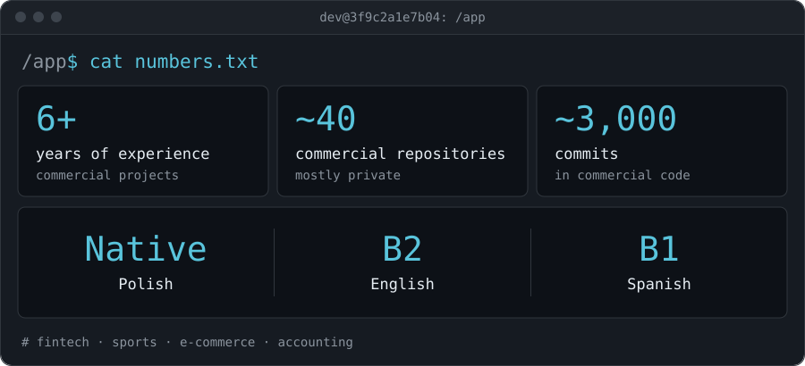

  

  

##  About

<dl><dd>

I'm a **Frontend & Full-stack Developer** specialising in **React and TypeScript** since 2021, with 6 years of commercial experience in web development overall. I look at the product as a whole: I start with the business needs, clarify requirements and edge cases, design the solution and carry it through to a working UI. I most enjoy building from scratch and finding creative solutions.

Day to day I work with ,  and , and build full-stack features with ,  and , or with Fastify when a product needs its own API. My strongest area is complex, multi-step interfaces, such as credit applications, lending and trading. I also build cross-platform products where the web app, mobile app and API share one type-safe contract.

I'm hooked on . In my free time I love building mobile apps with Expo, from a fitness app for athletes to a party game you control by tilting your phone.

</dd></dl>

  

##  In numbers

  

  

##  Tech stack

<dl><dd>

**Languages** 
    

**Frontend** 
        

**UI & styling** 
     

**Mobile** 
  ![NativeWind](https://img.shields.io/badge/NativeWind-161b22?style=flat-square&logo=data%3Aimage%2Fsvg%2Bxml%3Bbase64%2CPHN2ZyB4bWxucz0iaHR0cDovL3d3dy53My5vcmcvMjAwMC9zdmciIHZpZXdCb3g9IjAgMCAyNCAyNCI%2BPHBhdGggZmlsbD0iIzU5YzRkYyIgZD0iTTYuNDg4IDE0LjY0M2MyLjI4NC0uMTQzIDQuNjk2LjEzIDYuMzM4Ljk2NWMxLjE2Ny41NzUgMi40MiAxLjc1MiAyLjMwNiAzLjU2Yy0uMTE5IDEuMzMzLTEuMDggMi40MzQtMi4zMjQgMi43MzZjLTEuOTA2LjQ3LTMuOTAyLS44NDUtNC4xOC0yLjcwNmwtLjAyNi0uMjZhLjc3Ljc3IDAgMCAxIC43Mi0uNzQzYS43OC43OCAwIDAgMSAuODM4LjYxNmwuMDQuMjY1Yy4yMDEuOTI2IDEuMjU2IDEuNTk1IDIuMjIgMS4zNTdjLjYyLS4xNDggMS4wODctLjczIDEuMTQ2LTEuMzk1Yy4wODctLjk3OS0uNjg5LTEuNzExLTEuNDcxLTIuMDg3Yy0xLjI3Ny0uNjQ5LTMuMzU1LS45MjgtNS41MDUtLjc5NGMtMi4xNS4xMzUtNC4xNzQuNjcyLTUuMzUyIDEuNDc1YS44MDUuODA1IDAgMCAxLTEuMDk1LS4xODNhLjc0My43NDMgMCAwIDEgLjE5LTEuMDU3YzEuNjMyLTEuMTAzIDQuMDI1LTEuNjE1IDYuMTU1LTEuNzVtMTcuNTEtNC44NmMtLjA1MSAxLjE0Ny0uNTAzIDIuMTUyLTEuMzI1IDIuODljLS44MTQuNzMtMS45MzQgMS4xNDgtMy4yMzkgMS4yNDdjLS43MTUuMDU0LTEuNjY3LS4xMi0yLjY4LS4zMDZjLTEuMDYtLjE5NS0yLjMxLS40MzItMy43NTctLjU4Yy0yLjg4Mi0uMjk0LTYuNTUtLjIzMi0xMC44NjggMS4yOGEuNzk0Ljc5NCAwIDAgMS0xLjAwNi0uNDU2YS43NTMuNzUzIDAgMCAxIC40Ny0uOTcyYzQuNTkyLTEuNjA3IDguNTA5LTEuNjc0IDExLjU2OS0xLjM2MWMxLjUyMy4xNTUgMi44MzYuNDA1IDMuODg3LjU5OGMxLjA5OC4yMDIgMS44MDcuMzE4IDIuMjYzLjI4NGMxLjAzNi0uMDggMS43OTQtLjQgMi4yOTMtLjg0N2MuNDkxLS40NDEuNzg5LTEuMDU2LjgyNC0xLjg0M2MuMDQzLTEuMzkxLTEuMi0yLjMyNS0yLjQ1LTIuMzI2Yy0xLjI0My0uMDEyLTIuMi43MzctMi40NDcgMS45MTVhLjc4Ni43ODYgMCAwIDEtLjkyNi41OTRhLjc2Ljc2IDAgMCAxLS42MTUtLjg5NGMuMzktMS45MDMgMi4wMzEtMy4xNTIgNC4wMDQtMy4xMzNjMi4xNjYuMDQ0IDQuMDc1IDEuNjYgNC4wMDMgMy45MU05Ljc4IDQuOTg3Yy4xNTctMS43OSAxLjg4Mi0zLjIxOSAzLjc4LTIuOTU2YzEuNDI2LjIxMSAyLjUyMyAxLjMxMiAyLjY4IDIuNzcyYy4xODIgMS43MDgtLjk5NyAyLjk5NC0yLjQ4IDMuNjJjLTIuODA2IDEuMTcyLTMuNzUzIDEuMjAyLTguMiAyLjE3bC0yLjEzNi40NzdhLjc5Ljc5IDAgMCAxLS45NDYtLjU2MmEuNzYuNzYgMCAwIDEgLjU4My0uOTE1bDIuMTktLjQ5YzQuNTI0LS45ODcgNS4yMjYtLjk2MyA3Ljg4NC0yLjA3NGMuODktLjM2MSAxLjY1LTEuMDU1IDEuNTQxLTIuMDdjLS4wNzgtLjczNi0uNjQ1LTEuMzUtMS4zNC0xLjQyNWMtLjk4OS0uMTM3LTEuOTY2LjY2Ni0xLjk5NSAxLjY3YS43OC43OCAwIDAgMS0uODA4LjczOWMtLjU3Mi0uMDQtLjgxOC0uNDctLjc1My0uOTU2Ii8%2BPC9zdmc%2B)

**Backend & API** 
     

**Databases** 
 

**Web testing** 
    ![Playwright](https://img.shields.io/badge/Playwright-161b22?style=flat-square&logo=data%3Aimage%2Fsvg%2Bxml%3Bbase64%2CPHN2ZyB4bWxucz0iaHR0cDovL3d3dy53My5vcmcvMjAwMC9zdmciIHZpZXdCb3g9IjAgMCAyNCAyNCI%2BPHBhdGggZmlsbD0iIzU5YzRkYyIgZD0iTTIzLjk5NiA3LjQ2MmMtLjA1Ni44MzctLjI1NyAyLjEzNS0uNzE2IDMuODUtLjk5NSAzLjcxNS00LjI3IDEwLjg3NC0xMC40MiA5LjIyNy02LjE1LTEuNjUtNS40MDctOS40ODctNC40MTItMTMuMjAxLjQ2LTEuNzE2LjkzNC0yLjk0IDEuMzA1LTMuNjk0LjQyLS44NTMuODQ2LS4yODkgMS44MTUuNTIzLjY4NC41NzMgMi40MSAxLjc5MSA1LjAxMSAyLjQ4OCAyLjYwMS42OTcgNC43MDYuNTA2IDUuNTgzLjM1MiAxLjI0NS0uMjE5IDEuODk3LS40OTQgMS44MzQuNDU1Wm0tOS44MDcgMy44NjNzLS4xMjctMS44MTktMS43NzMtMi4yODZjLTEuNjQ0LS40NjctMi42MTMgMS4wNC0yLjYxMyAxLjA0Wm00LjA1OCA0LjUzOS03Ljc2OS0yLjE3MnMuNDQ2IDIuMzA2IDMuMzM4IDMuMTUzYzIuODYyLjgzNiA0LjQzLS45OCA0LjQzLS45ODFabTIuNzAxLTIuNTFzLS4xMy0xLjgxOC0xLjc3My0yLjI4NmMtMS42NDQtLjQ2OS0yLjYxMiAxLjAzOC0yLjYxMiAxLjAzOFpNOC41NyAxOC4yM2MtNC43NDkgMS4yNzktNy4yNjEtNC4yMjQtOC4wMjEtNy4wOEMuMTk3IDkuODMxLjA0NCA4LjgzMi4wMDMgOC4xODhjLS4wNDctLjczLjQ1NS0uNTIgMS40MTUtLjM1NC42NzcuMTE4IDIuMy4yNjEgNC4zMDgtLjI4YTExLjI4IDExLjI4IDAgMCAwIDIuNDEtLjk1NmMtLjA1OC4xOTctLjExNC40LS4xNy42MS0uNDMzIDEuNjE4LS44MjcgNC4wNTUtLjYzMiA2LjQyNi0xLjk3Ni43MzItMi4yNjcgMi40MjMtMi4yNjcgMi40MjNsMi41MjQtLjcxNWMuMjI3IDEuMDAyLjYgMS45ODcgMS4xNSAyLjgzOGE1LjkxNCA1LjkxNCAwIDAgMS0uMTcxLjA0OVptLTQuMTg4LTYuMjk4YzEuMjY1LS4zMzMgMS4zNjMtMS42MzEgMS4zNjMtMS42MzFsLTMuMzc0Ljg4OHMuNzQ1IDEuMDc2IDIuMDEuNzQzWiIvPjwvc3ZnPg%3D%3D)

**Mobile testing** 

**AI-assisted development** 
 

**DevOps & tooling** 
       

</dd></dl>

  

##  Featured project

<dl><dd>

### [FitMaster](https://github.com/david-dot-tsx/fitmaster-apps)

A cross-platform fitness ecosystem I designed and built on my own: a web console for coaches, a mobile app for athletes and a backend, all sharing one type-safe API contract in a Turborepo monorepo.

`Next.js` `Expo` `Fastify` `tRPC` `Prisma` `PostgreSQL` `Turborepo`

 

</dd></dl>

  

##  Stats

  
    
  

